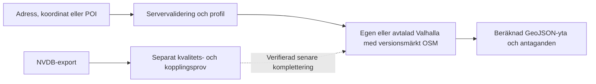

# Datakälls- och routingbeslut inför räckvidd

Issue #24, utredning 2026-10-13. Beslut för granskning: **OSM som nät och egen eller avtalad Valhalla som motor i första versionen av #9. NVDB reserveras för separat kvalitetskontroll och senare komplettering.** En full NVDB-import är inte en förutsättning för första räckviddsversionen. Ingen räckviddspolygon eller ny publik routingtjänst införs i denna PR.

## Vad som faktiskt har provats

Se maskinläsbart underlag i [ODINS_NVDB_SAMPLE.json](ODINS_NVDB_SAMPLE.json). Rådata ligger i ignorerad `work/`; rapporten innehåller sammanställningar och källhänvisningar, inte API-nycklar eller OSM-redigerares personuppgifter.

| Prov | Resultat | Vad det visar och inte visar |
| --- | --- | --- |
| OSM, bbox `13.843,58.388,13.847,58.392`, centrala Skövde | 219 highway-ways, 756 använda noder, 839 segmentförekomster. Inga saknade nodreferenser. | Ett litet, faktiskt nätuttag. Fullständiga ways kan sträcka sig utanför bbox; detta är inte en täckningskontroll för hela kommunen. |
| OSM, strukturell graf | Fem oriktade komponenter; största innehåller 716 noder, 94,7 %. | Koppling sker genom gemensamma nod-ID:n, inte genom korsande linjer. Grafen tar ännu inte hänsyn till rättigheter, hinder eller svängrestriktioner och får inte användas som färdig räckviddsmodell. |
| OSM, egenskaper | 21 ways med explicit oneway, två roundabouts, tre restriction-relationer. 39 med foot, 47 med bicycle, 134 med surface. 28 med numerisk maxspeed, samtliga 40. | Utelämnad tagg är inte liktydigt med förbud, fri passage eller att motorhastigheten är okänd. Därför behövs motorernas lands-/vägklassregler och särskilda kontroller. |
| NVDB WMS, tre infoklick | Tomt svar vid station/torgets valda centrum; en bilnätsgeometri vid norra centrum. | Tomt infoklick är inte bevis på att NVDB saknar vägar där. Svaret beror på klickposition, skala och tolerans. |
| NVDB WMS, koordinatordning | Med EPSG:4326 kom `lat,lon` i svarets koordinatarray; med explicit CRS:84 kom `lon,lat`. | Ett konkret skäl att inte mata äldre WMS-GeoJSON direkt till kartans WGS84-array. Använd deklarerad CRS, transformera och kontrollera mot provområdet. |
| Trafikverkets API, `RoadData` v1 | HTTP 200. Bounded prov på län 14/väg 26: 20 poster med längdreferenser, riktning och hastighet, ingen geografisk geometri. | Län-/vägprovet är inte geolokaliserat i Skövde-bboxen. `Direction` är en referensriktning och får inte ensamt tolkas som tillåten eller förbjuden färdriktning. |
| API, `RoadNetwork` v1; WFS-prov | HTTP 400 för den prövade objekttypen; WFS-adressen svarade 503. | Dessa försök gav inget nätuttag. De bevisar inte att andra dokumenterade API-modeller, annan version eller Lastkajen saknar nätdata. |

Overpass-försöken gav timeout/504. Ett avgränsat OSM Map API-uttag med JSON Accept-header fungerade. Det är ett utvecklingsprov; produktionsimport ska använda ett versionsmärkt regionalt PBF-utdrag eller en avtalad källa, inte återkommande kart-API-/Overpass-hämtningar. [OSM:s API-information](https://wiki.openstreetmap.org/wiki/API_v0.6).

För samma punkter, `58.3897,13.8457` till `58.3916,13.8454`, gav befintlig Valhalla-demo:

| Profil | Beräknad väg | Beräknad tid | Geometri |
| --- | --- | --- | --- |
| pedestrian, walking_speed 6 | 0,432 km | 269 sekunder | Ja |
| bicycle, city, cycling_speed 18 | 0,295 km | 63 sekunder | Ja |
| auto | 1,026 km | 193 sekunder | Ja |

Detta kontrollerar att vald motor hanterar färdsätten med olika vägval. Det nedladdade OSM-uttaget importerades **inte** till denna tjänst, och tjänstens tile-version är okänd. Tiderna är beräknade med profilkostnader och övergångar, inte uppmätta resor eller enbart sträcka/hastighet. Tre sekventiella punkt-till-punkt-anrop med 1,1 sekunds paus efter svar; inget isokronanrop eller områdessvep på publik demo.

## NVDB: åtkomst och lämpligt paket

NVDB anger tolv aktuella datamängder i Öppna API: bland annat Vägtrafiknät, Hastighetsgräns, FunktionellVägklass, FörbjudenFärdriktning och Gatunamn. Registrerad åtkomst krävs för hämtning. Detta är produktnamn; de ska inte utan schemakontroll användas som XML-objekttypnamn. [NVDB:s API-ingång](https://www.nvdb.se/sv/kund/hamta-aktuella-data/).

Lastkajen erbjuder paket och geografiska beställningar efter registrering och licensacceptans. Ingen registrering eller ny licensacceptans har gjorts i detta arbete. [Lastkajen](https://www.trafikverket.se/lastkajen).

Trafikverkets routingvägledning beskriver att råa referenslänkar kan ha anslutningar inne på en länk. Grafbygge som endast kopplar linjernas ändpunkter kan då skapa felaktiga öar. Egenskaper behöver dessutom knytas till rätt del av länken. En bild av korsande linjer är därför otillräckligt som routingbevis. [Ruttning med NVDB](https://lastkajen.trafikverket.se/assets/Ruttning_med_NVDB.pdf).

Två bättre exportkandidater än att bygga från WMS-fragment:

- **Vägdata för transportplanering:** homogeniserade segment där egenskaper samlats på länkar. Produktbladet anger bil-/cykelnät och CC0. Verifiera aktuell exporttäckning för gång separat. [Produktblad 2022-09-02](https://bransch.trafikverket.se/contentassets/11582b96b85244bf9f903430de6e910f/produktblad_vagdata-for-transportplanering_20220902_v1-1.pdf).
- **Data för Blåljusnavigering:** 2D-data, bil/cykel/gång enligt specifikationen, SWEREF 99 TM/EPSG:3006, GeoPackage och uppdatering varannan vecka. CC0 anges i specifikationen. Räddningsfordonsanpassningen innebär inte att samma passage-/färdregler ska användas för vanliga resor. [Specifikation 2025-03-01](https://bransch.trafikverket.se/contentassets/392a2ce32f4e4b329bda939c18469798/data-for-blaljusnavigering.pdf).

Någon Lastkajen-export har inte erhållits. Exportens faktiska topologi, schema, täckning, riktningsvärden och kompatibilitet med Valhalla är därför **inte verifierade**. Den föreslagna NVDB-kompletteringen ska få ett eget acceptansprov innan den påverkar routing.

## Koppling, kvalitet och regler

För en framtida NVDB-komplettering krävs följande i importen: deklarerad CRS till WGS84, länkreferens plus delsträckans mått/riktning, uppdelning vid anslutningar och ändrade egenskaper samt tester för bro/tunnel och förbud. Hastighetens giltighet kan bero på tid, fordon och riktning. En närmaste-linje-matchning, lika gatunamn eller samma vägnummer räcker inte. Behåll OSM- och NVDB-identiteter, datum och källor separat; osäker koppling ska lämnas omatchad.

OSM behöver kontroller av `access`, `foot`, `bicycle`, `oneway`, profilundantag, `restriction`, `barrier`, `surface`, `steps`, bro/tunnel/layer och verkliga övergångar. Saknade gång-/cykellänkar kompletteras först genom ett kvalitetstestat nätunderlag, aldrig genom en fågelväg. Provet visar möjlighet att analysera topologi, men inte att alla lokala taggar eller regler är korrekta.

| Färdsätt i #9 | Första modellbeslut |
| --- | --- |
| Gång | Valhalla pedestrian. 6 km/h som synligt, justerbart antagande; övergångar och framkomlighet hör också till modellen. |
| Cykel | Valhalla bicycle/city, preliminärt 18 km/h på lätt underlag. Granska yta, nivåer, tillträde och enkelriktningsundantag. |
| Bil | Valhalla auto med vägklass, hastighetsdata och korsningskostnader. 60 km/h över hela staden eller 90 över alla större vägar väljs inte som standard. Hastighetsgräns är inte snitthastighet. |
| Elsparkcykel | Egen tydligt märkt, cykelbaserad profil för cykelklassat fordon; preliminärt 15 km/h och högst 20 som standardscenario. Granska trappor och underlag. Ingen egen sådan motorprofil har implementerats/provats här. |

Valhallas `motor_scooter` avser moped/motoriserad scooter, inte automatiskt svensk elsparkcykel. Motorval och options är dokumenterade i [Valhallas routingreferens](https://valhalla.github.io/valhalla/api/route/api-reference/). För cykelklassad elsparkcykel anger Transportstyrelsen högst 20 km/h och högst 250 W kontinuerlig märkeffekt; därför används inte det ursprungliga förslaget 25–35 km/h som normalprofil. [Transportstyrelsen](https://www.transportstyrelsen.se/elsparkcykel).

## Licens, lagring och uppdatering

OSM är ODbL och kräver attribution; publicering av ändrade databaser måste hantera licensvillkoren. NVDB-paketens CC0 får inte användas som märkning på en kombinerad OSM-databas. Behåll datakällor/licenser och leveransmetadata i importmanifestet. [OSM:s licens](https://www.openstreetmap.org/copyright). Befintlig källpolicy i #7 gäller fortsatt; inga oprövade avtalsantaganden för större drift.

Det lilla OSM-uttaget var cirka 0,90 MB; highway-del med refererade noder cirka 0,20 MB. En strukturell analys tog 5,565 ms i ett lokalt prov, exklusive hämtning/JSON-parsning och motorbygge. Detta är inte en dimensionering av en svensk Valhalla-server. Valhalla tile-bygge, minne, disk, polygonprestanda och cacheträffar måste mätas på valt regionalt PBF och vald maskin innan räckvidd släpps.

Lagra ett versionsmärkt PBF, motorversion, profilversion och importdatum; bygg nya tiles separat och byt atomiskt efter acceptansprov. Behåll föregående fungerande version för återgång. Börja med ett litet regionalt utdrag; välj uppdateringsintervall efter leverantörens ändringsfrekvens och driftkapacitet. En framtida NVDB-export ska ha eget leveransdatum och separat jämförelse, utan att automatiskt ersätta hela grafen. Nätets datum, beräkningens antaganden och källfel ska synas i resultatet.

## Genomförande av #9 i ordning

1. **Motor och data:** ordna egen/avtalad Valhalla som stöder isochrone. Ett lokalt endpoint är inte konfigurerat i denna installation och Docker/Podman hittades inte i PATH under kontrollen. Detta är ett installationsval för nästa etapp, inte ett skäl att belasta publik demo. Skapa ett regionalt OSM-importmanifest och mät bygget.
2. **Gång först:** serverstyrd parameter-/område-/tidsvalidering, begränsning av samtidiga anrop, cache och timeout. Högst 1–3 tidskonturer och ett startläge per begäran i första etappen; exakta gränser fastställs efter mätning. Bekräfta motorversionens stöd i [isochrone-referensen](https://valhalla.github.io/valhalla/api/isochrone/).
3. **Kartflöde:** återanvänd gemensam adressökning, koordinater, kartklick och valfri sparad POI. Visa verklig beräknad GeoJSON-yta och antaganden, inte en radie som nätbaserat resultat. Otillgängligt/gammalt underlag ska få tydligt besked.
4. **Cykel och bil:** egna acceptansfall för enkelriktning, tillträde, bro/tunnel och svängförbud. Jämför konturer med beräknade punkt-till-punkt-tider; testa att otillåtna genvägar inte inkluderas.
5. **Elsparkcykel och jämförelse:** implementera och testa den särskilda profilen. Visa profilbegränsningar och att tid är modellvärde. Ingen mopedprofil som tyst ersättning.
6. **Valfri NVDB-förbättring:** hämta ett homogeniserat paket för Skövde med godkända exportvillkor, verifiera schema/topologi/axlar/referenser och dokumentera säkra matchningar. Detta ligger efter den första OSM-versionen; inga löften om NVDB-förbättrad noggrannhet före ett sådant prov.



## Återkörning och verifiering

Hämta ett litet OSM JSON-utdrag med källa/område/leveransdatum och håll rådata utanför Git. För samma strukturprov:

```sh
node scripts/nvdb-routing-study.mjs INPUT_OSM_JSON OUTPUT_SUMMARY_JSON
node --test scripts/nvdb-routing-study.test.mjs
```

Analysen gör inga nätanrop och inför ingen ny routingmotor. Två offlineprov kontrollerar att geometriska korsningar utan delade nod-ID:n inte skapar anslutning, och att saknade noder/ytor hanteras explicit. Det sparade provets aggregerade resultat återräknades med skriptet. Aktuella nät-/routingresultat kan ändras när källor uppdateras.
