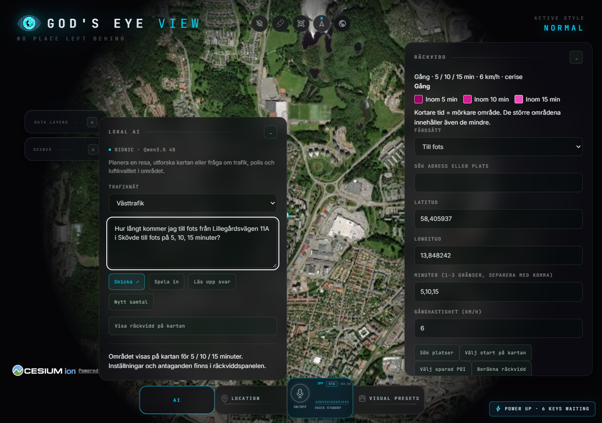
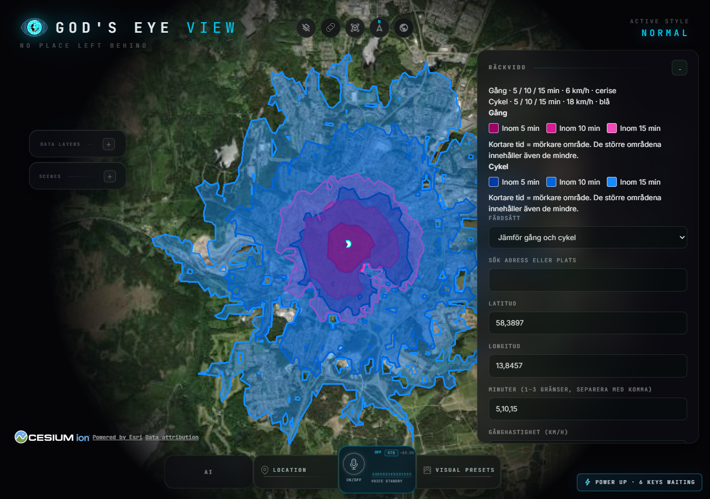

# ODINS EYE – användarmanual

Svensk guide till den lokala utvecklingsversionen. Uppdaterad **16 oktober 2026**.
Manualen beskriver funktionerna på arbetsgrenen; alla tillägg är ännu inte
sammanslagna till huvudgrenen. Skärmbildernas kartdata är exempel, inte aktuella
trafikbesked. Vissa menyer och rubriker är fortfarande på engelska.

## Innehåll

1. [Kom igång](#kom-igång)
2. [Hitta i gränssnittet](#hitta-i-gränssnittet)
3. [Sök en adress eller plats](#sök-en-adress-eller-plats)
4. [Byt kartbakgrund](#byt-kartbakgrund)
5. [Använd lokal AI](#använd-lokal-ai)
6. [Planera en resa](#planera-en-resa)
7. [Beräkna räckvidd](#beräkna-räckvidd)
8. [Spara egna platser och anteckningar](#spara-egna-platser-och-anteckningar)
9. [Visa datalager](#visa-datalager)
10. [Vanliga problem](#vanliga-problem)

## Kom igång

Om appen redan är igång öppnar du [ODINS EYE lokalt](http://127.0.0.1:4173).
Adressen fungerar på datorn där appens server körs.

För att starta en redan installerad kopia: öppna terminalen i projektets mapp
och kör:

```powershell
npm run dev -- --host 127.0.0.1 --port 4173 --strictPort
```

Låt terminalen vara igång medan du använder appen. För första installationen,
API-nycklar, lokal AI och kartunderlag: följ [installationsguiden](ODINS_SETUP.md).
Räckvidd kräver också ett installerat routingunderlag; se
[räckviddsinstallationen](ODINS_REACHABILITY.md#lokal-installation).
Alla datalager behöver inte vara konfigurerade för att grundkartan ska fungera.

**Prova på två minuter:**

1. Öppna **Location**, sök `Skövde` och välj rätt träff.
2. Öppna **Visual Presets → Map Source** och välj **Esri Satellite** eller **OSM**.
3. Öppna **AI** och skriv `Visa Hertig Johans torg i Skövde`.
4. Tryck **Skicka** och välj plats om flera alternativ visas.

## Hitta i gränssnittet

| Kontroll | Användning |
| --- | --- |
| **Location** | Sök efter adress, gata, ort eller annan plats och flytta kartan dit. |
| **AI** | Fråga med vanlig text om platser, resor och anslutna datakällor. |
| **Visual Presets** | Byt kartbakgrund och visuella inställningar. |
| **Data Layers** | Slå på eller av datalager och verktyg, bland annat Räckvidd och Egna POI. |
| **− / +** i paneler | Fäll ihop eller öppna panelen. |

Dra kartan för att förflytta dig och använd mushjulet för att zooma. En sökning
eller visning av ett resultat kan automatiskt flytta kameran. Fäll ihop paneler
om de täcker området du vill undersöka.

## Sök en adress eller plats

1. Öppna **Location** och skriv ett namn, en gata eller en adress.
2. Starta sökningen och granska alternativen.
3. Välj den träff vars ort och adress stämmer.

Du behöver inte alltid känna till husnumret. `Lillegårdsvägen i Skövde` söker
på gatan; `Lillegårdsvägen 11A i Skövde` är mer precist. Ett gatunamn utan
husnummer kan visa en representativ punkt på gatan, inte en särskild entré.

Samma adressökning används via AI. Skriv exempelvis:

> Visa Lillegårdsvägen i Skövde.

Lägg till kommun eller ort om ett namn finns på flera platser. Välj inte en
annan gata bara för att den råkar ligga överst. Flera datakällor kan ge nästan
identiska träffar; kontrollera namn och ort. Om adressen saknas, förtydliga sökningen.

## Byt kartbakgrund

Öppna **Visual Presets → Map Source**.

| Val | Vad du ser |
| --- | --- |
| **Esri Satellite** | Flyg-/satellitbilder. |
| **OSM** | Ritad gatukarta från OpenStreetMap. |
| **Bing Aerial / Bing Labels** | Bildbakgrund, med eller utan etiketter; kräver konfigurerad åtkomst. |
| **Google 3D** | 3D-bakgrund där tillgänglig och konfigurerad. |

OSM-valet är inte Lantmäteriets topografiska karta. Nedladdade vektorfiler från
Lantmäteriet är underlag för kartobjekt och analyser; de blir inte automatiskt
en färdig kartbakgrund. Bildmaterialets ålder varierar mellan platser.

## Använd lokal AI

Öppna **AI** i dockan, skriv frågan och tryck **Skicka**. AI:n kan använda de
verktyg som är anslutna; alla synliga datalager går inte att fråga om via AI.

| Du vill … | Exempel att skriva |
| --- | --- |
| Hitta en plats | `Visa Hertig Johans torg i Skövde.` |
| Planera en resa | `Jag vill resa från Göteborg Centralstation till Stockholm Centralstation imorgon kl 07:00.` |
| Hitta en gångrutt | `Jag vill gå från Skövde resecentrum till Hertig Johans torg i Skövde.` |
| Beräkna ett område | `Hur långt kommer jag till fots på 10 minuter från Skövde resecentrum?` |
| Se väghändelser | `Visa vägarbeten i Skövde.` |
| Se vägväder | `Visa vägväder i Skövde.` |

**Spela in** kräver mikrofonåtkomst och konfigurerad taligenkänning. Kontrollera
transkriberingen innan du skickar. **Läs upp svar** läser det senaste svaret.

**Nytt samtal** börjar om utan den tidigare resekontexten. Samtalsminnet är
tillfälligt och löper ut efter 30 minuters inaktivitet. Byte av trafiknät rensar
resekontexten. För räckvidd är det säkrast att skriva hela frågan på nytt när du
ändrar plats, färdsätt eller tidsgränser.

AI-svar kan kräva ett extra steg: välj en plats, hämta resor eller klicka på en
knapp för att visa resultatet på kartan. Läs källor och tidsstämplar i svaret.

## Planera en resa

1. Välj **Trafiknät**: Västtrafik, SL eller Hela Sverige. Använd Hela Sverige
   för resor mellan regioner.
2. Skriv start och mål, gärna med ort. Ange datum och tid om resan inte gäller nu.
3. Välj rätt adresser eller hållplatser om du får alternativ.
4. Hämta reseförslagen och tryck **Visa på kartan** för det förslag du vill se.

**Avgång:**

> Jag vill resa från Göteborg Centralstation till Stockholm Centralstation imorgon kl 07:00.

**Ankomst:**

> Jag vill resa från Brunnsparken i Göteborg till Lillegårdsvägen i Skövde imorgon och vara framme kl 09:00.

Klockslag utan ”vara framme” gäller normalt avgång. Kontrollera datum och avsikt
som skrivs ut i svaret. Skriv exakt datum om du vill undvika oklarheter kring
”på tisdag” eller ”nästa tisdag”. Tillgängliga framtida resor beror på tidtabellerna.

Resvägens färger: **vit = gång, blå = buss, lila = spårtrafik**. Det är en annan
färgförklaring än räckviddsområdenas. Om förslaget visar exempelvis **2/4 sträckor
med geometri** kan bara två delsträckor ritas korrekt. **Resväg saknas** betyder
att linjen saknar underlag; det betyder inte automatiskt att resan är inställd.
Beräknad järnvägsdragning är inte ett besked om tågets faktiska spårval.

## Beräkna räckvidd

Räckvidd visar vilka områden som beräknas kunna nås från en startplats inom en
eller flera tidsgränser. Du behöver inget resmål.

### Direkt i verktyget

1. Slå på **Räckvidd** i **Data Layers**.
2. Välj färdsätt.
3. Välj start med adressökning, kartklick, koordinater eller **Välj sparad POI**.
4. Ange 1–3 olika hela minuter mellan 1 och 30, exempelvis `5,10,15`.
5. Kontrollera hastighetsantagandet och tryck **Beräkna räckvidd**.

| Färdsätt | Standard och justering | Kartfärg |
| --- | --- | --- |
| Till fots | 6 km/h; valbart 0,5–8 | Cerise |
| På cykel | 18 km/h på plant underlag; valbart 5–35 | Blå |
| Med bil | Vägnätets hastigheter, med hastighetstak 120 km/h; valbart tak 10–120 | Orange |
| Med elsparkcykel | Uppskattning på cykelnätet, 20 km/h; valbart 5–20 | Lila |

Bilens hastighetstak betyder inte att bilen kör med samma hastighet på alla vägar.
Elsparkcykelmodellen avser cykelklassat fordon och är en uppskattning; batteriets
räckvidd och särskilda lokala elsparkcykelförbud ingår inte.

### Via AI

> Hur långt kommer jag till fots från Lillegårdsvägen 11A i Skövde på 5, 10, 15 minuter?

> Hur långt kommer man från Nyckelpigevägen 62 i Skövde på 30 minuter på cykel?

Ange färdsätt, minuter och start efter **från**. För flera tider i AI-texten:
separera med **komma och mellanslag**, semikolon eller ”och”.

Välj rätt plats om du får alternativ. Klicka därefter **Visa räckvidd på kartan**.
Knappen visar att beräkningen pågår, och kartan flyttas till resultatet. Inställningar
kan sedan ändras i räckviddspanelen. Ett färdigt textsvar är inte själva beräkningen.



### Förstå områdena och färgförklaringen

Med 5, 10 och 15 minuter får du tre överlappande områden:

- Det innersta, mörkaste området: **inom 5 minuter**.
- Det mellanstora området: **inom 10 minuter**, inklusive femminutersområdet.
- Det största, ljusaste området: **inom 15 minuter**, inklusive de mindre områdena.

Färgrutorna i panelen visar vilken ton som hör till varje tid. Vill du ha en enda
yta anger du bara exempelvis `10`. Välj **Jämför färdsätt** och kryssa i minst två av gång, cykel, bil och
elsparkcykel. De använder samma startpunkt och tidsgränser, med separata
hastighetsinställningar. Kryssrutorna i färgförklaringen visar eller döljer
varje beräknat resultat utan en ny beräkning.



Öppna **Antaganden och källor** för underlagsdatum och modellinformation. Områdena
följer nätet men deras ytor är interpolerade och kan visuellt täcka vatten eller
hinder. De är inte en garanti för passage till varje punkt inuti polygonen.

Starten måste kunna anslutas till en tillåten nätlänk inom 100 meter. Tiden från
den valda punkten till nätlänken ingår inte. Köer, höjd/lutning, väder och pauser
ingår inte i den här versionen. Kontrollera datumet på underlaget. Underlaget
omfattar Sverige; fortsättning över landsgränsen kan vara ofullständig.

Ändrade indata rensar gamla ytor och färgförklaringen. Beräkna igen för nytt resultat.
Slå av Räckvidd för att dölja verktyget och områdena.

Räckviddsmodellen kan använda färjelänkar och hissar. Aktuella färjeavgångar,
väntetider, medtagande av fordon och hissarnas driftstatus är inte verifierade.

### Färjor vid gång

Välj **Till fots** i räckviddspanelen och sedan **Färjor för gång**:

- **Statisk nätmodell** använder kartnätets färjelänkar utan aktuell tidtabell.
- **Utan färjor** beräknar gång på land och utesluter färjelänkar.
- **Göteborg: gång + färja, start nu (pilot)** använder avgångar på linje 285/286 mellan Lindholmspiren och Stenpiren, i båda riktningarna.

Piloten räknar bort gång till kajen, väntan och överfart från tidsbudgeten.
Du måste hinna till kajen minst två minuter före avgång. Korta anslutningar
till gångnätet uppskattas. Återstående gångtid avrundas nedåt till hela minuter.
Panelen visar vilka avgångar och tider som används. Uppskattade tider från
leverantören innebär inte att realtid har verifierats.

Varje beräkning börjar **nu** och tillåter högst en överfart. Om ingen avgång
ger minst en minut fortsatt gång visas bara landområdet. Fel vid hämtning av
färjedata visas som fel; ingen statisk färjereserv används.
Piloten finns ännu inte via AI eller jämförelse av färdsätt och stöder inte
framtida starttid. Cykelkapacitet, hissars driftstatus och faktiskt tillträde
till kajanslutningar är inte verifierade.

### Hitta ett flyg via lokal AI

Skriv exempelvis **Jag letar efter flight SK7714** eller **Visa flyg SAS7714**.
Flyglagret aktiveras och söker bland sina inlästa observationer. Endast exakt
anropssignal, ICAO24 eller registrering får starta följning på kartan; en
delträff väljs inte automatiskt. Trafiknätsvalet påverkar inte flygsökningen.

Bokningsnummer och anropssignal kan skilja sig åt. Ingen automatisk översättning
mellan dessa identifierare görs. Utebliven träff betyder därför inte att
flyget är inställt eller saknas, och verktyget ger inte tidtabellsstatus.

## Spara egna platser och anteckningar

POI betyder en sparad intressant plats eller kartnål.

1. Aktivera **Egna POI · Sparade platser** i **Data Layers**.
2. Tryck **Ny plats**. Ange namn och position genom sökning, kartklick eller koordinater.
3. Fyll i adress och anteckningar. **Hämta adress vid koordinater** kan föreslå
   en adress; kontrollera att den är rätt.
4. Tryck **Spara plats**.
5. Öppna platsen igen via listan eller kartnålen för att redigera den.

Att stänga av lagret döljer platserna utan att radera dem. **Ta bort plats** kräver
bekräftelse. Osparade ändringar överlever inte en omladdning.

**Säkerhetskopiera** laddar ned en JSON-fil med dina platser och anteckningar.
**Återställ säkerhetskopia** ersätter alla egna POI efter bekräftelse; appen sparar
först en automatisk kopia av tidigare innehåll. Förvara backupen där du vill ha den.

Platserna lagras lokalt i en databas, normalt under
`%LOCALAPPDATA%\ODINS_EYE\data\pois.sqlite` på Windows. De skickas inte automatiskt
till GitHub och följer inte med en kartlänk. Adressökning använder externa
platstjänster; anteckningarna skickas inte med i adressuppslaget.

## Vägar och järnvägar

Aktivera **Lantmäteriet · Vägar och järnvägar** i **Data Layers**.
Vägar visas grått, järnväg/spår med heldragen lila linje, och färjeleder cyan och streckat.
En teckenförklaring visas när lagret är aktivt. Stilen gäller det importerade
vektorlagret ovanpå kartan; väg- och spårfärger inbakade i bakgrundskartan ändras inte.
Spårlagret visar kartunderlag och är inte en markerad resa eller aktuell tågrörelse.

## Visa datalager

Öppna **Data Layers** och slå på det lager du vill undersöka. Klicka på ett
kartobjekt när lagret erbjuder ett informationskort. Slå av lager som skymmer kartan.
Tillgänglighet beror på datakälla, konfiguration och geografiskt område.

| Lager/funktion | Vad du bör kontrollera |
| --- | --- |
| Trafik och kollektivtrafik | Tidpunkt, planerad tid/prognos och om data saknas. |
| Vägkameror | Bildens tidpunkt och källa; kamerabilden behöver inte vara direktsänd video. |
| Väghändelser | Giltighet och beskrivning. En närliggande händelse behöver inte påverka din resa. |
| Vägväder | Observationstid och stationens avstånd. Temperatur ensam bekräftar inte halka. |
| Fartyg | Rapporterad ETA, navigationsstatus och uppgifternas ålder. Saknade värden visas som Uppgift saknas. |
| Luftkvalitet | Stationens mättid och vilka ämnen som faktiskt har mätvärden. |
| Översvämning/brandrisk | Skilj beräknade scenarier och historiska värden från aktuella observationer. |

Fartygskortets **Visa senaste spår** visar tillgängliga positionsuppgifter;
det är inte en prognos för fartygets framtida rutt. **Rapporterad ETA** är
fartygets rapporterade ankomsttid, inte appens egen beräkning.

## Vanliga problem

| Problem | Gör så här |
| --- | --- |
| Sidan kan inte öppnas | Kontrollera att den lokala servern är igång och att du använder rätt adress/port. |
| Fel plats hittas | Lägg till ort och välj rätt alternativ. Gatunamn utan husnummer är mindre precisa. |
| AI ber om ett resmål för en områdesfråga | Skriv hela frågan med ”Hur långt kommer jag”, färdsätt, minuter och ”från” följt av platsen. Kontrollera att sidan är uppdaterad. |
| AI ger ett svar men kartan ändras inte | Välj eventuell adress och klicka Visa räckvidd på kartan eller reseförslagets Visa på kartan. Läs eventuellt felbesked. |
| Anropen är tillfälligt begränsade | Vänta ungefär en minut innan du försöker igen. Att snabbt klicka igen eller börja nytt samtal kringgår inte den gemensamma gränsen. |
| Lokal routingdata saknas | Följ routinginstallationen eller be den som sköter installationen att aktivera underlaget. |
| Räckvidd kan inte beräknas | Välj start nära en väg som tillåter färdsättet. Kontrollera tidsgränser och hastighet. |
| Flera områden visas | Du har angett flera tider. Läs färgförklaringen eller ange bara en tidsgräns. |
| Delar av en resväg saknas | Läs uppgiften om geometritäckning. Saknade linjer kan inte ersättas med säkra färdvägar utan underlag. |
| Ett lager är tomt | Kontrollera täckning, källstatus, tidpunkt och konfiguration. Tomt eller misslyckat svar betyder inte säkert att inga händelser finns. |
| Ändringar verkar saknas | Spara POI-formulär först, ladda sedan om sidan och gör beräkningen igen. |

## Mer hjälp

- [Installation](ODINS_SETUP.md)
- [Räckvidd: underlag och antaganden](ODINS_REACHABILITY.md)
- [Egna POI och säkerhetskopiering](ODINS_POI.md)
- [AI-verktyg och samtalsminne](ODINS_AI_TOOLS.md)
- [Resefrågor och datum](ODINS_TRAVEL_INPUT.md)
- [Projektets status](ODINS_STATUS.md)

När du rapporterar ett problem: ange frågan du skrev, valt färdsätt/trafiknät,
vad du förväntade dig och vilket fel som visades. En bild av resultatet hjälper.
Lämna API-nycklar och privata anteckningar utanför felrapporten.
