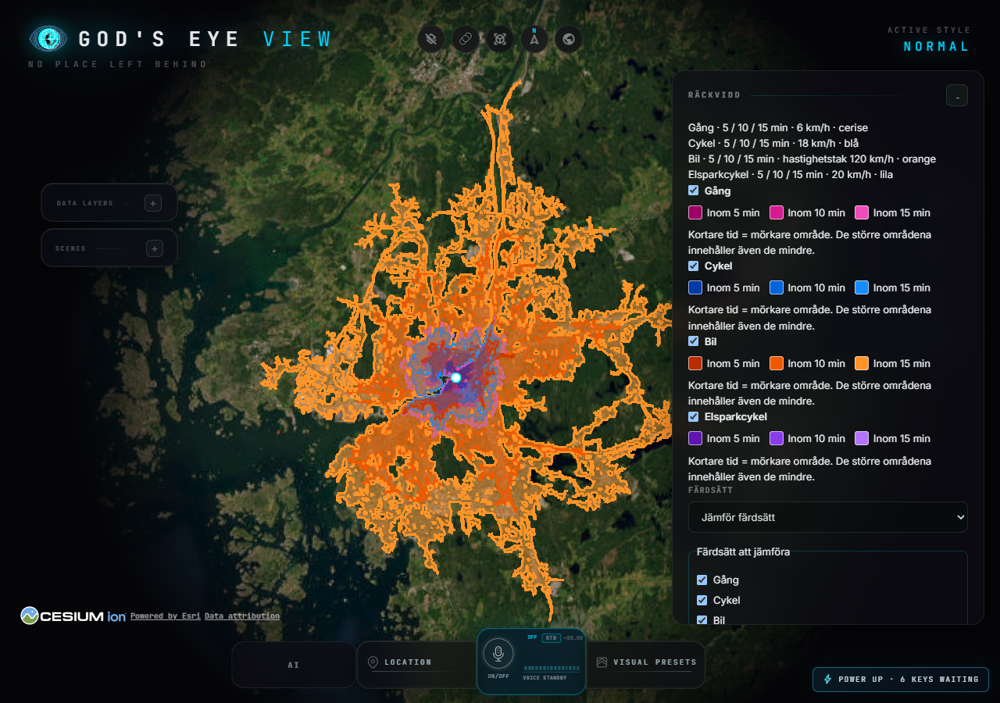

# Räckviddsprov i Göteborg – 2026-10-18

## Omfattning

Underlag: `sweden-20261012-v1`. Tre fasta koordinatpar nära Hisingsbron, Älvsborgsbron och Lindholmen–Stenpiren. Koordinaterna är provpunkter, inte verifierade entréer eller adresser. Alla fyra profiler använder produktionsarbetaren för 5/10/15-minuterskonturer. Separata diagnostiska rutter använder samma lokala graf och profilinställningar i båda riktningar. Ingen extern eller aktuell trafikdata används.

- 12 anrop till produktionsarbetaren: tre giltiga konturer och anslutning inom 100 m i samtliga fall.
- 24 riktade rutter: bro/färja verifierad i grafens kantattribut, inklusive OSM way-id. Inga bilrutter använde färja.
- 36 målpunkt/tidsgräns-kontroller: polygonmedlemskap överensstämmer med framåtruttens beräknade tid för dessa provpunkter.
- Webbläsarprov i Göteborg: fyra färdsätt, tre tidsgränser, visa/dölj, fel/versionsbyte, rensning och mobilvy passerar.

## Resultat

Tiderna är modellresultat, inte uppmätta restider. Bil använder hastighetstak 120 km/h med statiska väghastigheter, inte konstant 120 km/h. Gång 6, cykel 18 och elsparkcykel 20 km/h enligt profilernas antaganden.

| Prov | Färdsätt | Framåt km/min | Bakåt km/min | Mål inom konturer (min) |
|---|---|---|---|---|
| Hisingsbron banks | walk | 1.197 / 12.01 | 1.197 / 12.01 | 15 |
| Hisingsbron banks | bicycle | 1.387 / 4.85 | 1.469 / 5.07 | 5, 10, 15 |
| Hisingsbron banks | car | 2.040 / 3.09 | 2.237 / 3.52 | 5, 10, 15 |
| Hisingsbron banks | scooter | 1.387 / 4.38 | 1.469 / 4.58 | 5, 10, 15 |
| Alvsborgsbron banks | walk | 2.557 / 25.67 | 2.557 / 25.67 | Ingen |
| Alvsborgsbron banks | bicycle | 2.818 / 9.68 | 4.112 / 14.38 | 10, 15 |
| Alvsborgsbron banks | car | 3.643 / 3.74 | 2.634 / 2.69 | 5, 10, 15 |
| Alvsborgsbron banks | scooter | 2.818 / 8.74 | 4.112 / 13.00 | 10, 15 |
| Lindholmen to Stenpiren | walk | 1.946 / 19.67 | 1.946 / 19.67 | Ingen |
| Lindholmen to Stenpiren | bicycle | 2.424 / 17.16 | 2.759 / 18.39 | Ingen |
| Lindholmen to Stenpiren | car | 5.013 / 7.15 | 5.949 / 8.43 | 10, 15 |
| Lindholmen to Stenpiren | scooter | 2.424 / 16.76 | 2.759 / 17.85 | Ingen |

## Slutsatser och begränsningar

Broproven använder kanter med bridge=true. Skillnader mellan färdriktningar och färdsätt syns, men detta bevisar inte att varje lokal tillträdesregel eller enkelriktning är korrekt. Grafens regler har inte kontrollerats mot aktuell skyltning. Befintliga syntetiska regeltester är en separat kontroll.

Lindholmen–Stenpiren använder färjelänk 285 för gång/cykel/elsparkcykel. Bil tar broförbindelse. Färjeval och tider är statiska modellantaganden: aktuella avgångar, väntetid, driftläge och tillåtelse att ta med cykel/elsparkcykel är inte verifierade. Gångprovet vid Hisingsbron använder hiss; hissens driftstatus ingår inte.

Områdesfyllning är interpolerad och kan täcka vatten eller hinder mellan vägar. Dessa 36 punktkontroller friskriver inte hela polygonerna från sådana fel. Testet bevisar inte att varje vattenpassage i Göteborg är rätt. Ingen särskild järnvägsövergång kontrollerades i detta prov.

Rekommenderad uppföljning: tydliggör färje- och hissberoenden i resultatet och utvärdera val för att undvika dem. Ändra inte alla färjeval utan att först bestämma önskat beteende.

## Återskapa

Kör `.venv/Scripts/python.exe scripts/qa-gothenburg-reachability.py` med installerad svensk graf. Skriptet läser aktiv version, skriver GeoJSON och diagnostik till `work/gothenburg-qa/`. Resultaten är versionsbundna; ändrat underlag kan kräva granskning av förväntningarna.

[Detaljer inklusive koordinater och passerade OSM-kanter](gothenburg-reachability/results.json)

